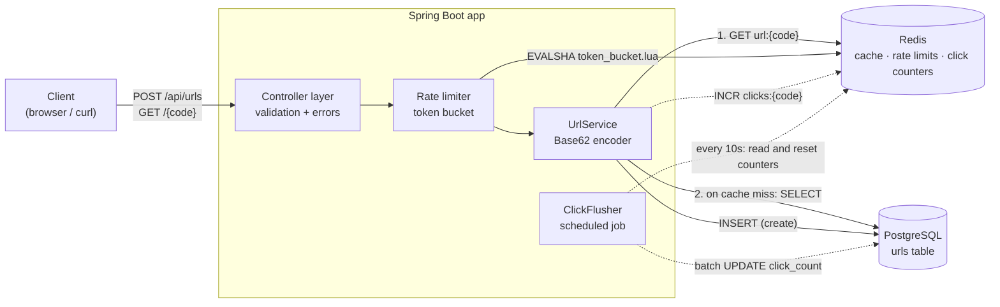
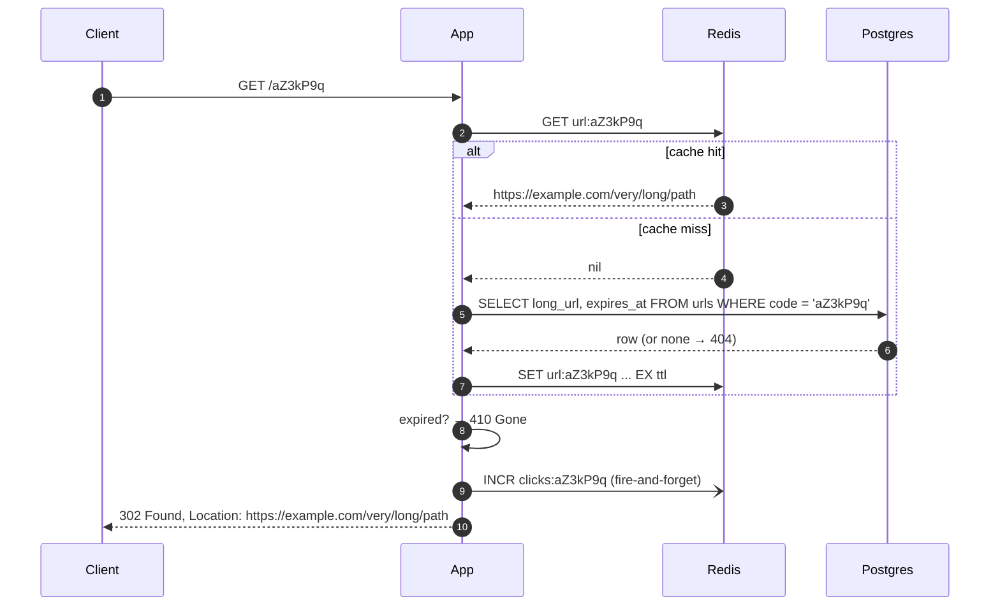
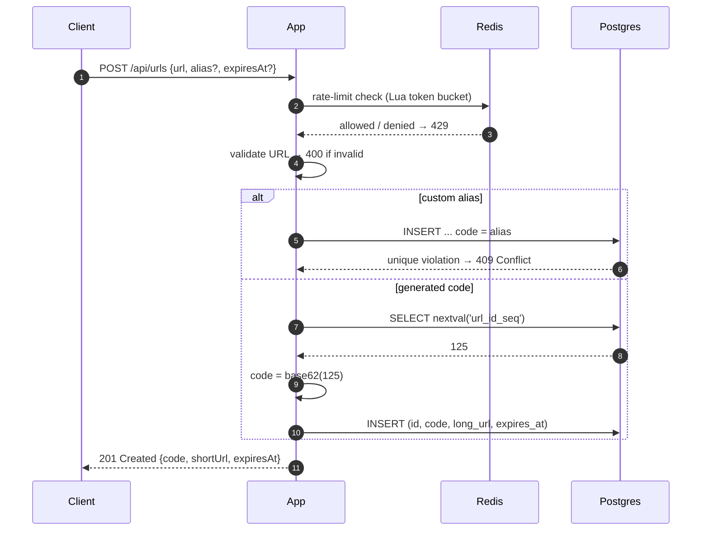

# url-minify

A production-style URL shortener with caching, rate limiting, link expiry, click counting, and real load-test benchmarks.

> **Status:** 🚧 Milestone 1 (API & storage) in progress
> **Live demo:** _coming soon_

---

## Features

- Shorten any `http(s)` URL to a 7-character code: `POST /api/urls`
- Fast redirects with a `302`: `GET /{code}`
- Custom aliases (`/my-portfolio`), with `409 Conflict` if one is taken
- Link expiry: an expired link returns `410 Gone`
- Redis cache-aside on the redirect hot path
- Per-IP rate limiting (Redis token bucket, run atomically in a Lua script)
- Click counting that never slows down a redirect (buffered in Redis, flushed to Postgres in batches)
- Structured JSON logs and a `/health` endpoint

## Tech stack

| Layer        | Choice                          | Why |
|--------------|---------------------------------|-----|
| Language     | Java 21 + Spring Boot 3         | Mature web stack, easy to test, widely used in industry |
| Database     | PostgreSQL 16                   | Source of truth; sequences + unique indexes make ID generation simple and safe |
| Cache        | Redis 7                         | Sub-millisecond reads for redirects; also backs the rate limiter and click counters |
| Local infra  | Docker Compose                  | One command starts the app, Postgres, and Redis |
| Testing      | JUnit 5 + Testcontainers        | Integration tests against a real Postgres and Redis |
| Load testing | k6                              | Scriptable load tests with p50/p95/p99 output |
| CI           | GitHub Actions                  | Runs the tests on every push |

---

## Architecture



Solid arrows are on the request path. Dotted arrows are the async click-counting path.

### Redirect flow (the hot path)

Redirects outnumber creates by roughly 100:1, so this path is the one to optimize.



### Create flow



---

## API

### `POST /api/urls`: create a short link

```http
POST /api/urls
Content-Type: application/json

{
  "url": "https://example.com/some/very/long/path?with=params",
  "alias": "my-link",                 // optional, 3–30 chars, [A-Za-z0-9_-]
  "expiresAt": "2026-12-31T23:59:59Z" // optional, must be in the future
}
```

| Status | Meaning |
|--------|---------|
| `201 Created` | `{ "code": "aZ3kP9q", "shortUrl": "http://localhost:8080/aZ3kP9q", "expiresAt": null }` |
| `400 Bad Request` | Invalid URL, alias, or expiry date |
| `409 Conflict` | The alias is already taken |
| `429 Too Many Requests` | Rate limit exceeded (includes a `Retry-After` header) |

### `GET /{code}`: redirect

| Status | Meaning |
|--------|---------|
| `302 Found` | `Location` header points to the original URL |
| `404 Not Found` | Unknown code |
| `410 Gone` | The link has expired |

### `GET /api/urls/{code}`: link stats

Returns `{ code, url, createdAt, expiresAt, clickCount }`.

### `GET /health`

Reports app, Postgres, and Redis status.

Errors use one JSON shape everywhere:

```json
{ "status": 409, "error": "ALIAS_TAKEN", "message": "Alias 'my-link' is already in use" }
```

---

## Data model

```sql
CREATE SEQUENCE url_id_seq START 100000;   -- start high so codes aren't 1–2 chars

CREATE TABLE urls (
    id           BIGINT       PRIMARY KEY,
    code         VARCHAR(32)  NOT NULL,
    long_url     TEXT         NOT NULL,
    is_custom    BOOLEAN      NOT NULL DEFAULT FALSE,
    created_at   TIMESTAMPTZ  NOT NULL DEFAULT now(),
    expires_at   TIMESTAMPTZ,
    click_count  BIGINT       NOT NULL DEFAULT 0
);

CREATE UNIQUE INDEX ux_urls_code ON urls (code);
```

Redis keys:

| Key | Value | TTL |
|-----|-------|-----|
| `url:{code}` | long URL + expiry | 24h, or until the link expires if that's sooner |
| `rl:{ip}` | token bucket state (`tokens`, `last_refill`) | a few minutes |
| `clicks:{code}` | pending click count | none (reset by the flusher) |

---

## Design decisions

These are the trade-offs worth being able to explain in an interview.

**1. Counter + Base62 instead of hashing.**
Hashing the long URL (MD5/SHA → take 7 chars) causes collisions you have to detect and retry, and the same URL always maps to the same code. A database sequence guarantees uniqueness with no collision checks. Base62 (`0-9a-zA-Z`) gives 62⁷ ≈ 3.5 trillion codes in 7 characters.
_Trade-off:_ sequential codes are guessable (`aZ3kP9q` → `aZ3kP9r`). Mitigation: shuffle the ID with a reversible bijection (e.g. multiply by a large odd number modulo 62⁷) before encoding.

**2. `302` instead of `301`.**
A `301` is cached by browsers forever, which means fewer requests to us but no click counts and no working expiry. A `302` keeps every click visible to the server. A product that sells analytics wants `302`.

**3. Cache-aside on the read path.**
Read Redis first; on a miss, read Postgres and populate the cache. Links never change after creation, so cache invalidation is trivial (only expiry matters). Optionally cache "not found" briefly to stop repeated lookups of bad codes from reaching the DB.

**4. Custom aliases share the `code` column.**
A single unique index covers both generated and custom codes, so a collision either way is caught by the database, not by a race-prone "check then insert".

**5. Clicks are counted out of band.**
`INCR` in Redis is O(1) and fire-and-forget. A scheduled job flushes counts to Postgres in batches, so a redirect never waits on a DB write.
_Trade-off:_ up to ~10 seconds of counts can be lost if Redis crashes. That's acceptable for analytics.

**6. Rate limiting as a Lua script.**
Read-refill-decrement must be atomic, or two concurrent requests can both take the last token. Redis runs a Lua script as one atomic operation.

### Scaling to 1B links (thought exercise)

- **Storage:** ~500 bytes/row × 1B ≈ 500 GB. Postgres can hold it; shard by `code` hash beyond that.
- **ID generation:** a single sequence becomes a bottleneck. Hand each app server a block of IDs (e.g. 10,000 at a time) so the counter is off the hot path.
- **Reads:** cache hit ratio is everything. Popular links follow a power law, so a modest Redis cluster absorbs most traffic. Put a CDN or edge cache in front for the hottest links.
- **Cleanup:** a background job deletes expired rows in batches.

---

## Benchmarks

_To be filled in during Milestone 3._ Run with k6 against the Docker Compose stack on: `<machine specs>`.

| Scenario | RPS | p50 | p95 | p99 | Error rate |
|----------|-----|-----|-----|-----|------------|
| Redirect, cache **off** | | | | | |
| Redirect, cache **on**  | | | | | |
| Create                  | | | | | |

---

## Running locally

```bash
# start Postgres + Redis + the app
docker compose up --build

# create a link
curl -s -X POST localhost:8080/api/urls \
  -H 'Content-Type: application/json' \
  -d '{"url":"https://github.com"}'

# follow it
curl -i localhost:8080/<code>

# tests (needs Docker running for Testcontainers)
./mvnw test
```

---

## Roadmap

### Milestone 1: API & storage
- [ ] `POST /api/urls` and `GET /{code}` returning a `302` redirect
- [ ] Postgres schema with a unique index on `code` (Flyway migration)
- [ ] Base62 encoding of a counter-based ID, with unit tests
- [ ] Input validation and consistent error responses (`400` / `404`)

### Milestone 2: Caching, aliases & expiry
- [ ] Redis cache-aside on the redirect path
- [ ] Custom aliases with a uniqueness check (`409` on conflict)
- [ ] Expiration via `expiresAt`, returning `410` when expired
- [ ] Integration tests against real Postgres + Redis

### Milestone 3: Scale & measure
- [ ] Per-IP rate limiting (Redis token bucket via a Lua script)
- [ ] k6 load test: p50/p99 with and without the cache
- [ ] Async click counting (Redis `INCR` + batched flush)
- [ ] Structured logs + `/health`

### Milestone 4: Ship it
- [ ] Minimal web UI for creating links
- [ ] GitHub Actions CI running the tests
- [ ] Benchmark table filled in
- [ ] Deployed (Fly.io / Render / Railway) with a live link

### Stretch
- [ ] ID-range allocation per app server
- [ ] QR code generation
- [ ] OpenAPI spec + generated client
- [ ] Analytics dashboard (clicks over time, referrers)
